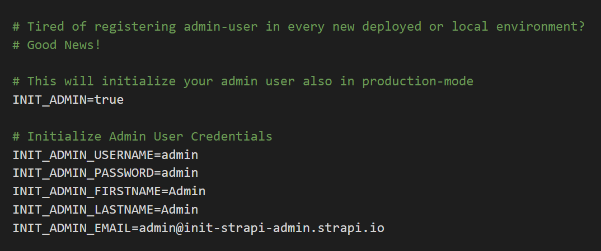
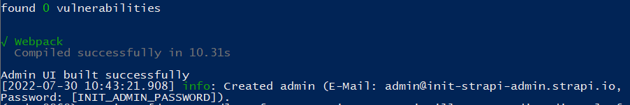
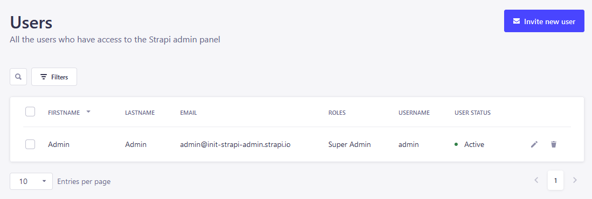

# strapi-plugin-init-admin-user

Creates a Strapi admin user on startup. Simplifies working with multiple Strapi environments.



## Compatibility

| Plugin | Strapi | Node    |
| ------ | ------ | ------- |
| 2.x    | v5     | 20+     |
| 0.2.x  | v4     | 14 - 20 |

```bash
# Strapi v5
npm install strapi-plugin-init-admin-user

# Strapi v4
npm install strapi-plugin-init-admin-user@0.2.3
```

## Quick start

Set the environment variables with your initial values and start Strapi (`npm run develop`):

```
INIT_ADMIN_USERNAME=admin
INIT_ADMIN_PASSWORD=Admin1234
INIT_ADMIN_FIRSTNAME=Admin
INIT_ADMIN_LASTNAME=Admin
INIT_ADMIN_EMAIL=admin@init-strapi-admin.strapi.io
```

You can use `INIT_ADMIN` as a **JSON string** instead of the variables above. Extra keys are passed through to the created user.

```
INIT_ADMIN='{"username": "admin", "password": "Admin1234", "firstname": "Admin", "lastname": "Admin", "email": "admin@init-strapi-admin.strapi.io"}'
```

By default the plugin only runs in `development`. To run it in other environments set the following (or use `INIT_ADMIN` as a JSON string):

```
INIT_ADMIN=true
```

Watch for the `info` log:

> Created admin (E-Mail: admin@init-strapi-admin.strapi.io, Password: [INIT_ADMIN_PASSWORD]).

**Note:** The first admin is only created if there is **no existing admin user** in your Strapi application.





## Configuration

Everything above also works from `config/plugins.ts`. Values set there win over the environment variables.

```ts
export default ({ env }) => ({
  'strapi-plugin-init-admin-user': {
    enabled: true,
    config: {
      // 'auto' (default): run in development, or when INIT_ADMIN is set
      // 'always': run in every environment, 'never': disable
      mode: 'auto',

      // the first admin, created only when there are no admin users yet
      admin: {
        email: env('INIT_ADMIN_EMAIL', 'admin@example.com'),
        password: env('INIT_ADMIN_PASSWORD'),
        firstname: 'Admin',
        lastname: 'Admin',
      },

      // roles are created first, and only if they don't exist yet (no permissions are assigned)
      roles: [{ name: 'QA', code: 'qa', description: 'Quality assurance' }],

      // more admins, created when no admin with that email exists
      // `roles` is required, and takes role codes or names
      admins: [
        {
          email: 'editor@example.com',
          firstname: 'Ed',
          password: 'Editor1234',
          roles: ['strapi-editor'],
        },
      ],

      // content API tokens, created when no token with that name exists
      apiTokens: [{ name: 'ci', type: 'read-only' }],
    },
  },
});
```

`admins`, `roles` and `apiTokens` can also be provided as JSON arrays through `INIT_ADMINS`, `INIT_ROLES` and `INIT_API_TOKENS`.

### Secrets from files

Every `INIT_ADMIN_*` variable (and `INIT_ADMINS`, `INIT_ROLES`, `INIT_API_TOKENS`) can be read from a file by appending `_FILE`. This works with Docker and Kubernetes secrets:

```
INIT_ADMIN_PASSWORD_FILE=/run/secrets/strapi_admin_password
```

### API tokens

Without an `accessKey` the generated token is printed **once** in the log. Setting `accessKey` stores your own value instead. This relies on how Strapi stores token keys internally, so test it with your Strapi version before depending on it.

## Security

- The defaults (`admin` / `admin`) are only meant for local development. The plugin logs a warning when they are used outside `development`.
- It also warns when the password doesn't meet Strapi's password policy (8+ characters, a lowercase letter, an uppercase letter and a number).
- Passwords are never logged.
- `admins` and `roles` are re-created on every start if you delete them. Remove them from the configuration once you no longer need them.

## Upgrading from 0.x

- 2.x supports Strapi v5 only. Stay on `strapi-plugin-init-admin-user@0.2.3` for Strapi v4.
- The environment variables are unchanged.
- The default `admin` password is still accepted, but now logs a warning.

## Contributing

See [CONTRIBUTING.md](CONTRIBUTING.md).

## Support

Leave a '**Thank You**' with a ⭐️ on [Github](https://github.com/minzig/strapi-plugin-init-admin-user) and have a nice day!

## Links

[Plugin on Github](https://github.com/minzig/strapi-plugin-init-admin-user)  
[Plugin on NPM](https://www.npmjs.com/package/strapi-plugin-init-admin-user)  
[Plugin on Strapi Marketplace](https://market.strapi.io/plugins/strapi-plugin-init-admin-user)

## License

[MIT License](LICENSE) - Created by [minzig](https://github.com/minzig)🍃
