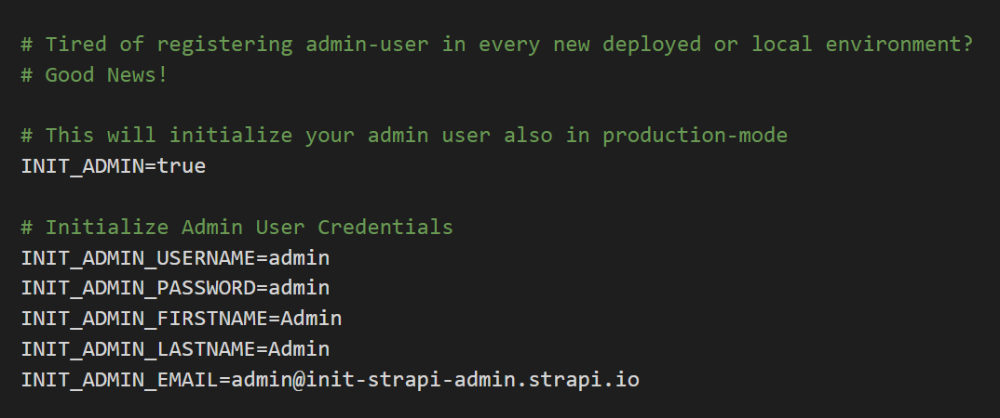
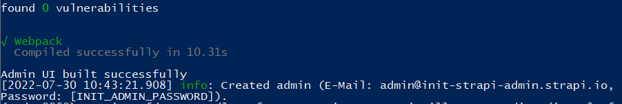
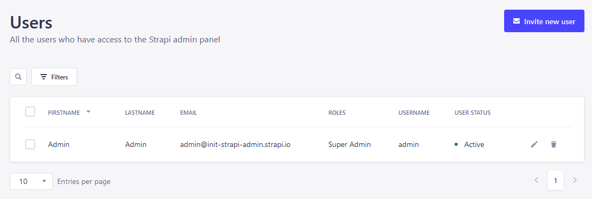

# @baybreezy/strapi-plugin-init-admin-user

Creates a Strapi admin user on startup, along with any extra admins, roles and API tokens you need. Simplifies working with multiple Strapi environments.



## About this fork

This is a maintained fork of [minzig/strapi-plugin-init-admin-user](https://github.com/minzig/strapi-plugin-init-admin-user), created by [minzig](https://github.com/minzig). Credit for the original plugin and idea goes to them.

Strapi v5 support (a TypeScript rewrite on the Strapi Plugin SDK) and the tooling around it were sent upstream as [#15](https://github.com/minzig/strapi-plugin-init-admin-user/pull/15) and [#16](https://github.com/minzig/strapi-plugin-init-admin-user/pull/16) in October 2026. Those pull requests haven't had a response yet, and the original repository and npm package haven't been updated since November 2023. So that Strapi v5 users can use the plugin today, it's published here as `@baybreezy/strapi-plugin-init-admin-user`.

The plugin id, configuration and environment variables are the same as the original, so switching is a package swap (see [Migrating](#migrating-from-strapi-plugin-init-admin-user)). If the original project becomes active again, the plan is to contribute these changes back.

## Compatibility

| Package                                    | Version | Strapi | Node    |
| ------------------------------------------ | ------- | ------ | ------- |
| `@baybreezy/strapi-plugin-init-admin-user` | 1.x     | v5     | 20+     |
| `strapi-plugin-init-admin-user` (original) | 0.2.x   | v4     | 14 - 20 |

```bash
# Strapi v5
npm install @baybreezy/strapi-plugin-init-admin-user

# Strapi v4 (original package)
npm install strapi-plugin-init-admin-user@0.2.3
```

## Quick start

Set the environment variables with your initial values and start Strapi (`npm run develop`):

```
INIT_ADMIN_USERNAME=admin
INIT_ADMIN_PASSWORD=Admin1234
INIT_ADMIN_FIRSTNAME=Admin
INIT_ADMIN_LASTNAME=Admin
INIT_ADMIN_EMAIL=admin@init-strapi-admin.strapi.io
```

You can use `INIT_ADMIN` as a **JSON string** instead of the variables above. Extra keys are passed through to the created user.

```
INIT_ADMIN='{"username": "admin", "password": "Admin1234", "firstname": "Admin", "lastname": "Admin", "email": "admin@init-strapi-admin.strapi.io"}'
```

By default the plugin only runs in `development`. To run it in other environments set the following (or use `INIT_ADMIN` as a JSON string):

```
INIT_ADMIN=true
```

Watch for the `info` log:

> Created admin (E-Mail: admin@init-strapi-admin.strapi.io, Password: [INIT_ADMIN_PASSWORD]).

**Note:** The first admin is only created if there is **no existing admin user** in your Strapi application.





## Configuration

Everything above also works from `config/plugins.ts`. Values set there win over the environment variables. The plugin key is `strapi-plugin-init-admin-user`, the same as the original package.

```ts
export default ({ env }) => ({
  'strapi-plugin-init-admin-user': {
    enabled: true,
    config: {
      // 'auto' (default): run in development, or when INIT_ADMIN is set
      // 'always': run in every environment, 'never': disable
      mode: 'auto',

      // the first admin, created only when there are no admin users yet
      admin: {
        email: env('INIT_ADMIN_EMAIL', 'admin@example.com'),
        password: env('INIT_ADMIN_PASSWORD'),
        firstname: 'Admin',
        lastname: 'Admin',
      },

      // roles are created first, and only if they don't exist yet
      // permissions are applied only when the role is created
      roles: [
        {
          name: 'QA',
          code: 'qa',
          description: 'Quality assurance',
          copyPermissionsFrom: 'strapi-editor',
          permissions: ['plugin::upload.read'],
        },
      ],

      // more admins, created when no admin with that email exists
      // `roles` is required, and takes role codes or names
      admins: [
        {
          email: 'editor@example.com',
          firstname: 'Ed',
          password: 'Editor1234',
          roles: ['strapi-editor'],
        },
      ],

      // content API tokens, created when no token with that name exists
      apiTokens: [
        { name: 'ci', type: 'read-only' },
        { name: 'frontend', type: 'custom', permissions: ['api::article.article.find'] },
      ],
    },
  },
});
```

`admins`, `roles` and `apiTokens` can also be provided as JSON arrays through `INIT_ADMINS`, `INIT_ROLES` and `INIT_API_TOKENS`.

### Role permissions

A role created by the plugin can start with permissions:

- `copyPermissionsFrom` copies every permission of an existing role, by code or name (for example `strapi-editor` or `strapi-author`).
- `permissions` adds permissions on top. A string is an action (`'plugin::upload.read'`). Use an object for content-type actions: `{ action: 'plugin::content-manager.explorer.read', subject: 'api::article.article' }`.

```
INIT_ROLES='[{"name": "QA", "code": "qa", "copyPermissionsFrom": "strapi-editor"}]'
```

Permissions are only applied when the plugin **creates** the role. A role that already exists is never changed, so edits made in the admin panel are kept.

### Custom API tokens

Besides `read-only` and `full-access`, tokens can be `custom`. A custom token is limited to the content API actions listed in `permissions`:

```
INIT_API_TOKENS='[{"name": "frontend", "type": "custom", "permissions": ["api::article.article.find", "api::article.article.findOne"]}]'
```

Actions follow Strapi's `api::<api>.<controller>.<action>` / `plugin::<plugin>.<controller>.<action>` format. Unknown actions are rejected by Strapi and logged.

### Secrets from files

Every `INIT_ADMIN_*` variable (and `INIT_ADMINS`, `INIT_ROLES`, `INIT_API_TOKENS`) can be read from a file by appending `_FILE`. This works with Docker and Kubernetes secrets:

```
INIT_ADMIN_PASSWORD_FILE=/run/secrets/strapi_admin_password
```

### API token access keys

Without an `accessKey` the generated token is printed **once** in the log. Setting `accessKey` stores your own value instead, for any token type. This relies on how Strapi stores token keys internally, so test it with your Strapi version before depending on it.

## Security

- The defaults (`admin` / `admin`) are only meant for local development. The plugin logs a warning when they are used outside `development`.
- It also warns when the password doesn't meet Strapi's password policy (8+ characters, a lowercase letter, an uppercase letter and a number).
- Passwords are never logged.
- `admins` and `roles` are re-created on every start if you delete them. Remove them from the configuration once you no longer need them.
- Role permissions are applied only when a role is created, never to existing roles.

## Migrating from `strapi-plugin-init-admin-user`

```bash
npm uninstall strapi-plugin-init-admin-user
npm install @baybreezy/strapi-plugin-init-admin-user
```

- 1.x supports Strapi v5 only. Stay on `strapi-plugin-init-admin-user@0.2.3` for Strapi v4.
- The plugin key in `config/plugins.ts` (`strapi-plugin-init-admin-user`) and the environment variables are unchanged.
- The default `admin` password is still accepted, but now logs a warning.

## Contributing

See [CONTRIBUTING.md](CONTRIBUTING.md). Issues and pull requests are welcome on [GitHub](https://github.com/BayBreezy/strapi-plugin-init-admin-user).

## Links

[Plugin on GitHub](https://github.com/BayBreezy/strapi-plugin-init-admin-user)  
[Plugin on npm](https://www.npmjs.com/package/@baybreezy/strapi-plugin-init-admin-user)  
[Original project by minzig](https://github.com/minzig/strapi-plugin-init-admin-user)

## License

[MIT License](LICENSE). Originally created by [minzig](https://github.com/minzig)🍃, maintained by [Behon Baker](https://github.com/BayBreezy).
